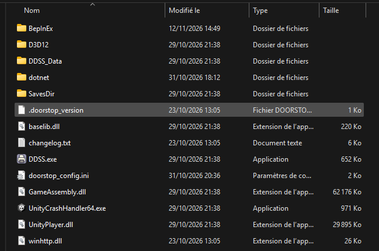

<p align="center"></p>

<h1 align="center">ZoomerMod</h1>

Mod fan-made pour **Dale & Dawson Stationery Supplies** : nouvelles tâches, rôles et effets, à jouer entre amis.

**Ce mod est fait pour être joué en serveur privé uniquement, entre joueurs qui ont tous le mod. Ne l'utilise pas en partie publique.**

Ce mod est **vibe codé** : écrit en grande partie avec une IA (Claude), testé en jeu entre amis. Attends-toi à quelques bugs.

## Installation

1. Télécharge le zip de la dernière version dans [Releases](../../releases).
2. Steam > clic droit sur Dale & Dawson > Gérer > Parcourir les fichiers locaux.
3. Dézippe **tout** le contenu du zip dans ce dossier (à côté de `DDSS.exe`). Si Windows demande de remplacer des fichiers, accepte.
   Le dossier doit ressembler à ça (avec en plus les fichiers `ZoomerMod ON.bat` et `ZoomerMod OFF.bat`) :

   

4. Double-clique sur **`ZoomerMod ON.bat`** (dans ce même dossier) pour activer le mod. Le jeu doit être fermé.
5. Lance le jeu depuis Steam. Le premier lancement est long (1 à 3 minutes).

Si tout marche, `ZoomerMod vX.Y.Z` s'affiche en bas à droite du menu principal.
Tout le monde dans la partie doit avoir la même version. **Joue uniquement en lobby privé, avec des gens qui ont le mod.**

`ZoomerMod OFF.bat` / `ZoomerMod ON.bat` (dans le dossier du jeu) désactivent / réactivent le mod.

## Nouvelles tâches

Elles tombent comme celles du jeu : **bleues** (Specialist), **rouges** (Slacker) et **noires** (sabotages).

### Bleues

| Tâche | Ce qu'il faut faire |
|---|---|
| Discours inspirants | Regarder 10 s de vidéo motivante dans l'app GlucksTube de son PC |
| Tupperware 2.0 | Prendre la bolo maison au frigo, la manger, puis laver le tupperware à l'évier |
| Transfert de mails | Transférer 3 mails de travail reçus, chacun à un collègue différent |
| Inventaire du frigo | Sortir 3 aliments périmés du frigo (ça sent) et les jeter |
| Formation sécurité | Vérifier 3 extincteurs (1 chance sur 4 qu'il parte tout seul), puis envoyer le compte rendu au manager |
| Café pour l'équipe | Déposer 2 cafés dans le porte-tasse d'autres postes |
| Audit Cybersécurité | Désactiver puis réactiver l'antivirus de 3 PC différents (gare aux pubs) |
| STONKS | Imprimer une courbe et la faire signer par le manager |
| Sauvegarde des serveurs | Lancer la sauvegarde en salle serveur (échoue si les serveurs sont en panne) |
| Macron Explosion | Imprimer 3 fois le tract FO de son PC, puis le déposer dans 3 bacs à papier d'autres postes |
| 1 to 1 | 15 s en tête-à-tête avec le chef dans son bureau, sans personne d'autre |
| 1 to 1 Manager | La version du chef (ou de l'Assistant) : 15 s seul avec n'importe qui dans son bureau |
| Commande de fournitures | Commander par mail au fournisseur, récupérer le carton à l'accueil, le ranger à l'entrepôt |
| Présentation client | Préparer au tableau blanc, puis présenter 15 s dans la salle de réunion |

### Rouges

| Tâche | Ce qu'il faut faire |
|---|---|
| Rail de bureau | Prendre le sachet à son bureau et aller le sniffer aux toilettes |
| Recyclage | Manger du caca aux toilettes (effet Nauséeux garanti) |
| Lettre au boss | Insulter le manager par mail, depuis le PC (et l'adresse) d'un collègue |
| Tupperware 2.0 : ni vu ni connu | Manger la bolo et remettre le tupperware sale au frigo |
| Rafraîchissement d'équipe | Asperger un collègue à l'extincteur |
| Moulin à vent | Dessiner dans Paint, imprimer, punaiser au panneau d'affichage |
| L'Autographe-gate | Dessiner, imprimer, et faire signer le dessin par un autre joueur |
| Douche froide | Verser un gobelet d'eau sur la tête d'un collègue |
| Dégât des eaux | Renverser un gobelet d'eau sur un PC : il court-circuite jusqu'à ce qu'on le sèche |
| Power Nap | Dormir 15 s à son poste sans que le manager passe à côté (on entend le ronflement) |
| Spam RH | Envoyer une chaîne de mails à 5 collègues |
| Photocopie de fesses | S'asseoir sur la photocopieuse, récupérer la copie, la punaiser |
| Karaoké : Rise of the Machines | Mettre le CD en salle de pause et chanter 15 s sans que le manager débarque |
| Pascal Prout | Prendre le coussin péteur dans le placard de la gelée et le poser sur la chaise du collègue désigné : le prochain qui s'y assoit pète et se relève d'un bond |

### Noires (sabotages)

| Tâche | Ce qu'il faut faire |
|---|---|
| Panne générale | Lancer un virus sur tous les PC depuis la salle serveur ; seul le manager peut tout réparer |
| Inkish Coffee | Verser de l'encre dans la machine à café : ses cafés rendent nauséeux jusqu'à réparation |
| Attention Mr. Zoomer | Saboter le broyeur : le prochain qui broie un document y laisse sa main (jusqu'à 60 s) |
| Agrafeuse piégée | Piéger l'agrafeuse d'un poste : le prochain qui s'y assoit ou touche la gelée se fait agrafer le doigt |

## Rôles bonus

Au début de la partie, des **rôles bonus** sont tirés au hasard : 1 à 5-6 joueurs, 2 à 7-8, 3 à 9-10, et ainsi de suite
(jamais deux fois le même rôle). Chacun s'active ou se désactive dans l'onglet **Rôles** des réglages du lobby.
L'écran de fin affiche tous les rôles bonus de la partie, réussis ou ratés. Après un vote de remplacement, un Jester ou
un Rival n'est choisi comme nouveau manager qu'en dernier recours (s'il n'y a pas d'autre spécialiste) ; promu, sa mission
est ratée. Un rôle bonus n'est jamais transmis à un
autre joueur après un renvoi.

### Le Jester (caché)

Un spécialiste devient **en secret** le Jester. Personne ne le sait, ni le manager, ni l'hôte.

- **Son but** : se faire **virer par le manager**. Pour tout le monde, c'est un spécialiste (tâches bleues et rouges).
- **Ses tours** : la moitié (arrondie au supérieur) des licenciements possibles. Chaque licenciement d'un autre joueur lui
  en coûte un. Plus de tours, ou promu manager par un vote : il redevient un simple spécialiste (raté).
- **Viré à temps** : écran de renvoi d'un spécialiste, puis il continue la partie en Janitor. À la fin, **il est le seul
  gagnant** (écran de fin rose avec son nom). Sinon, son rôle est révélé à la fin.
- Carte de rôle rose au début de la partie ; **maintenir F1** affiche ses règles et ses licenciements restants.

### Le Syndicaliste (connu des fainéants)

Un **fainéant** devient le Syndicaliste, seulement si les fainéants n'ont pas la majorité. Les autres fainéants savent qui
c'est ; personne d'autre.

- **Sa mission** : faire **renverser le manager par un vote de remplacement** (peu importe qui lance le vote).
- Ça ne compte que si les fainéants n'ont pas la majorité au moment du vote. Viré avant : mission ratée.
- **Récompense** : un badge sur l'écran de fin. Il gagne ou perd toujours avec les fainéants.
- Carte de rôle jaune ; **maintenir F1** affiche sa mission (et, chez les fainéants, qui est le Syndicaliste).

### Le Rival (caché, neutre)

Un spécialiste ou un fainéant devient **en secret** le Rival et reçoit une **cible** au hasard : toujours un
**spécialiste** (jamais le Jester). Personne ne le sait, pas même sa cible.

- **Neutre** : il fait les tâches de son camp pour passer inaperçu, mais la victoire de son camp ne compte pas pour lui.
- **Sa victoire** : que sa cible **se fasse virer**, par n'importe quel moyen. Viré avant : raté.
- **Cible qui s'échappe** (elle quitte la partie ou devient manager après un vote) : le Rival **devient Jester**, avec la
  moitié des licenciements restants (au moins 2). C'est le seul cas où il peut y avoir deux Jesters.
- **Promu manager** par un vote : mission ratée (il pourrait virer sa cible lui-même).
- Carte de rôle grise ; **maintenir F1** affiche sa cible et ses règles.

### Le Pistonné (caché)

Un spécialiste ou un fainéant devient **en secret** le Pistonné, le neveu du patron. Il gagne ou perd avec son camp.
Seulement dans les parties à **4 licenciements ou plus** (le menu debug peut le forcer en dessous). C'est de préférence
un joueur sans sous-rôle ; sinon il peut aussi être RH ou analyste (il garde ses pouvoirs).

- **Premier renvoi : gratuit et annulé.** « X est le neveu du patron ! » chez tout le monde (son camp n'est pas
  révélé). Personne n'est viré, le licenciement n'est pas décompté, la réunion se termine.
- **Deuxième renvoi : il part pour de bon**, et « Vous avez vraiment viré le neveu du patron ! » s'affiche :
  - spécialiste : le manager perd **un licenciement de plus** (même le dernier) ;
  - fainéant : l'entreprise gagne **10 % de productivité** (ce qui peut faire gagner les spécialistes).
- Une rétrogradation de manager après un vote n'est pas un renvoi.
- Écran de fin : « sauvé par son oncle » si la protection a servi, « jamais inquiété » sinon.
- Carte de rôle orange (même s'il est aussi RH ou analyste) ; **maintenir F1** affiche ses règles et si sa protection a déjà servi.

### L'Usurpateur (caché)

Un fainéant qui prend l'apparence des autres. Il gagne avec les fainéants.

- **Mémoriser** : action « Mémoriser l'apparence » sur un joueur (à côté de la claque, visible de lui seul), à 1 m
  maximum, 2 s sans bouger.
- **Se déguiser / se changer** : sans rien viser, maintenir F pendant 2 s. Il prend l'apparence, le nom et la couleur
  de la victime, chez tout le monde. 2 min d'attente après chaque déguisement, comptées dès que le costume est enlevé
  (en pause pendant la réunion elle-même).
- **Réunion** : alerte avec compte à rebours à l'appel ; le costume tombe tout seul à la fin des 15 s de trajet.
- Carte de rôle en dégradé rouge fainéant → bleu spécialiste ; un bandeau en bas de l'écran rappelle son état.

### Le Maître chanteur (caché)

Un fainéant qui bâillonne un joueur. Il gagne avec les fainéants.

- Action « Faire chanter » sur un joueur (visible de lui seul), à 1 m maximum, 2 s de maintien. Une victime par
  réunion, jamais le manager, jamais deux fois de suite la même personne.
- Au vrai début de la réunion suivante, la victime l'apprend par un gros message et ne peut plus ni parler ni écrire
  jusqu'à la fin de la réunion. Personne d'autre ne le sait.

### Le Cost Killer (caché)

Un spécialiste qui peut virer lui-même un joueur, une seule fois par partie. Il gagne avec les spécialistes.

- Viser un joueur à 1 m maximum et maintenir E 5 s, hors réunion, à partir de la fin de la première réunion. Jamais
  le manager.
- Le renvoi passe par le jeu : même écran qu'un renvoi du manager, Janitor ou spectateur selon le réglage, et il
  compte comme un licenciement.
- Un fainéant : mission réussie, il continue en simple spécialiste. Un spécialiste : il est viré juste après sa
  victime (son écran suit), et sa démission ne compte pas (la limite est relevée de 1 avant son renvoi).
- Le Jester : pas de sanction, et le Jester ne gagne pas (il n'a pas été viré par le manager). Le Pistonné : protégé,
  le tir est perdu sans sanction ; au 2e renvoi, pas de licenciement de malus pour le manager.

**Couleur de l'écran de fin** : si le Jester ou le Rival gagne, l'écran est à sa couleur chez tout le monde (Jester rose
> Rival gris). Sinon, l'écran a la couleur du camp gagnant, sauf chez certains titulaires : le Syndicaliste qui a réussi
(jaune), le Pistonné encore en poste dont le camp gagne (orange), l'Usurpateur quand les fainéants gagnent (dégradé).

## Cosmétiques gratuits

Ajoutés à la fin des listes de l'écran de personnalisation, gratuits pour tous. La sauvegarde du jeu reste propre :
sans le mod, le personnage revient à ses objets d'origine.

- **Cheveux** : Ponpons (deux chignons, raie au milieu ; les chignons disparaissent sous un chapeau).
- **Chapeaux** : sombrero, casque viking, bonnet de Noël, casque de Solaire, couronne, bonnet de bouffon, casque audio, chapeau de pirate, haut-de-forme.
- **Lunettes** : lunettes 3D, monocle. **Yeux** : UwU.
- **Barbe** : moustache ronde. **Accessoire** : nez rouge, masque de Glucks. **Crâne** : crâne raboté.
- **Manteau** : peignoir (léopard, éponge, Lebowski, cuir…), tabard de Solaire.
- **Veste** (manager) : doudoune sans manches, fermée ou ouverte, noire ou bleu marine.
- **Couleurs** : chemise des tests, léopard, cotte de mailles, Noël, t-shirt noir au logo, t-shirts « Kaiju chat », « Bouffer en entier » et Pingu, hoodie Carpenter.

## Effets et événements

- **Nauséeux** : écran vert et tangage. Vient du caca, des cafés à l'encre, ou des aliments périmés gardés trop longtemps en main.
- **Panne générale** : écran virus partout, LED des serveurs en rouge et alarme, jusqu'à la réparation par le manager.
- **Main dans le broyeur** : la victime est bloquée, crie, saigne ; un collègue peut la dégager.
- **Pluie de pubs** : 10 fenêtres de pub sur un PC, à fermer une par une (parfois pendant l'Audit Cybersécurité).
- **Sauvegarde** : LED des serveurs en bleu pendant la sauvegarde.
- **PC en court-circuit** : étincelles, fumée et écran d'erreur jusqu'à ce que quelqu'un le sèche.
- **Douche** : voile d'eau puis gouttes sur l'écran de la victime, et pas mouillés pendant 15 s.
- **Extincteur** : nuage blanc sur l'écran des aspergés.
- **Caca** : éclaboussures marron en continu autour des toilettes et en bas de l'écran du mangeur.
- **Tract FO** : il apparaît de temps en temps au hasard sur le bureau d'un PC.

## Ce que fait (et ne fait pas) le mod

- Le zip contient [BepInEx 6](https://github.com/BepInEx/BepInEx) (le chargeur de mods) et `DaleMod.dll`, compilé depuis ce dépôt.
- Le mod ne se connecte à rien sur internet : il passe uniquement par le réseau du jeu, entre les joueurs de la partie.
- Il ne lit ni n'écrit rien en dehors du dossier du jeu.
- Il ne touche pas aux cosmétiques payants ni aux lobbies publics.

Certains antivirus signalent les mods BepInEx (`winhttp.dll` injecte le chargeur dans le jeu) : c'est un faux positif
connu de tous les jeux moddés avec BepInEx. Le code est entièrement ici, tu peux le compiler toi-même.

## Désinstaller

Supprime `winhttp.dll` du dossier du jeu : le jeu redevient normal. Pour tout enlever, supprime aussi
`doorstop_config.ini`, `.doorstop_version`, `ZoomerMod ON/OFF.bat` et les dossiers `BepInEx` et `dotnet`.

## Compiler

Prérequis : le jeu installé avec BepInEx 6 IL2CPP (lancé une fois, pour générer `BepInEx/interop`), le SDK .NET 6+.

```
dotnet build DaleMod -c Debug      # compile et copie le mod dans le jeu
powershell -ExecutionPolicy Bypass -File tools\package.ps1   # zip de release dans dist\
```

Le chemin du jeu est dans `DaleMod/DaleMod.csproj` (`GameDir`) et `tools/package.ps1`.

Les médias sous droits d'auteur ne sont pas dans le dépôt : la vidéo et certains sons sont dans le zip de release
(`BepInEx/plugins/DaleMod/Assets/`), à poser dans `DaleMod/Assets/`.

La musique du karaoké (`Assets/karaoke/rise.wav`) est aussi dans le zip de release, pas dans le dépôt.

## Crédits

Musique du karaoké : *Rise of the Machines*, Music by Karl Casey @ White Bat Audio.

Voir [`DaleMod/Assets/CREDITS.txt`](DaleMod/Assets/CREDITS.txt). Mod non officiel, sans lien avec les développeurs du jeu.
